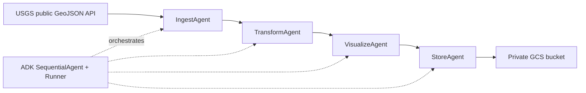

# Seismic: an ADK earthquake data pipeline

**Public repository: [Ahsnyder/quake-agent-pipeline](https://github.com/Ahsnyder/quake-agent-pipeline)**

The live API and local ADK workflow are verified. The Google Cloud project `earthquake-class-project` is configured, but its billing status is disabled and a real GCS run has not been completed. Local previews do not fulfill the cloud-storage requirement. See `docs/validation.md` for the validation record.

Four Google Agent Development Kit (ADK) agents turn the public USGS past-seven-days earthquake feed into a validated dataset and a standalone HTML dashboard, then store the artifacts in Google Cloud Storage (GCS).

## Architecture



- **IngestAgent:** fetches the feed with a 30-second timeout and up to three attempts for transient errors; preserves the response bytes and a SHA-256 hash.
- **TransformAgent:** validates numeric fields, event timestamps and coordinate ranges; excludes non-earthquake records; keeps the latest valid revision per event ID; filters at magnitude 2.5 by default; aggregates UTC daily counts, magnitude bands and depth bands, plus mean/max magnitude and mean depth. It rejects an entirely invalid nonempty feed.
- **VisualizeAgent:** produces an accessible HTML report with summary cards, bar charts, a strongest-events table, provenance and a quality ledger. No CDN, server or JavaScript is needed to view it.
- **StoreAgent:** uploads the raw GeoJSON, processed JSON and HTML to a unique GCS run prefix using create-only generation preconditions. The SDK checks upload integrity; the agent reloads object metadata to check sizes and records object generations. It writes the completion manifest last. It never changes bucket access permissions.

`cli.py` only configures a session and calls the **ADK Runner**. The **SequentialAgent** invokes all four `BaseAgent` subclasses, which communicate through ADK event state deltas. Exceptions stop downstream agents. This is a deterministic, agent-driven workflow, not an LLM planner: it requires no Gemini key and makes no model calls. ADK supports non-LLM subagents. This release pins ADK 2.14.1 and uses its supported template workflow interface; migration to the newer graph API is discussed in the improvements document.

## Install (Python 3.11 or 3.12)

Clone the public repository and change into its root folder:

```bash
git clone https://github.com/Ahsnyder/quake-agent-pipeline.git
cd quake-agent-pipeline
```

Then create a Python environment:

```bash
python -m venv .venv
```

Activate it on Windows PowerShell:

```powershell
.\.venv\Scripts\Activate.ps1
```

Or on macOS/Linux:

```bash
source .venv/bin/activate
```

Install the tested, fully pinned dependencies and project:

```bash
python -m pip install -r requirements.lock
python -m pip install --no-deps --no-build-isolation -e .
```

If `python` is unavailable on Windows, use an installed Python interpreter or `py -3.12`. Do not commit `.venv`, `.env` or credentials. Environment variables in `.env.example` are examples; the application does not automatically load `.env`.

## Preview without cloud credentials

Offline preview with the included real USGS snapshot:

```bash
python -m quake_pipeline.cli --local --fixture examples/demo/raw.geojson
```

Fetch the live public API and preview locally:

```bash
python -m quake_pipeline.cli --local
```

Open the printed `out/<run-id>/index.html` path in a browser. A prebuilt report is in `examples/demo/index.html`. Every execution still goes through the ADK agents. The offline option replays an existing snapshot; it does not fetch current data. **Local mode does not fulfill the cloud-storage requirement.** If `GCS_BUCKET` is set, clear it before using `--local`.

## Run with Google Cloud Storage (required before submission)

Prerequisites: a Google Cloud project with billing enabled, Google Cloud CLI installed, and permission to create/use a bucket. Storage and network operations can incur cloud charges. Use an existing suitable private bucket when possible.

Authenticate and configure your actual project:

```bash
gcloud auth login
gcloud config set project YOUR_PROJECT_ID
gcloud auth application-default login
gcloud auth application-default set-quota-project YOUR_PROJECT_ID
gcloud services enable storage.googleapis.com --project=YOUR_PROJECT_ID
```

If you need a new bucket, choose a globally unique name:

```bash
gcloud storage buckets create gs://YOUR_UNIQUE_BUCKET --project=YOUR_PROJECT_ID --location=us-central1 --uniform-bucket-level-access --public-access-prevention
```

The runtime identity needs object create and read permissions in that bucket (for example, the bucket-scoped `roles/storage.objectUser` role). An administrator may need to grant this role. Do not add service-account keys to this repository. The client uses Application Default Credentials from the local login or the runtime's attached identity.

Run against the live API:

```bash
python -m quake_pipeline.cli --project YOUR_PROJECT_ID --bucket YOUR_UNIQUE_BUCKET --min-magnitude 2.5
```

Cloud mode is the default. Missing bucket configuration or failed uploads cause a nonzero exit; the pipeline never silently falls back to local mode. Successful runs print a `gs://.../manifest.json` completion marker. Confirm the files exist:

```bash
gcloud storage ls gs://YOUR_UNIQUE_BUCKET/earthquake-pipeline/ --recursive
```

Objects are private. To view a report on another machine, download its `index.html` through authenticated Cloud Storage access and open it locally. Public web hosting is not required by this assignment.

## Outputs and data interpretation

Each run uses `out/<UTC-timestamp>-<random-id>/` locally and `gs://<bucket>/<prefix>/<run-id>/` in cloud storage:

| Artifact | Purpose |
| --- | --- |
| `raw.geojson` | Exact source response bytes |
| `processed.json` | Retained events, statistics, exclusions and provenance |
| `index.html` | Standalone dashboard |
| `manifest.json` | Artifact hashes/sizes; cloud object generations and URIs when uploaded |
| `events.jsonl` | Local ADK stage event summaries |
| `failure.json` | Local error details, only if a run fails |

The first four artifacts are uploaded in cloud mode; event/error diagnostics stay local. A run without the cloud completion manifest is incomplete, even if some artifacts were uploaded. Failed runs may leave partial cloud objects; automatic cleanup is future work.

The quality ledger satisfies `input = invalid + non_earthquake + duplicates + below_threshold + retained`. Invalid records are removed before deduplication. The latest *valid* revision wins, even if a newer invalid revision exists. Missing numeric fields are not replaced by zero. Empty valid feeds or thresholds yielding zero matches generate an explicit empty report with `N/A` statistics. Depths below zero are preserved. Daily charts show dates with retained records, with partial first/last days. The feed is a changing snapshot with variable regional detection coverage, so counts are not a complete measure of global activity. Magnitudes may use different scales and are logarithmic; the mean is only descriptive, not an energy estimate.

## Tests

```bash
python -m pytest -q
```

Tests exercise real ADK stage handoffs, quality accounting, latest-revision deduplication, missing/nonfinite values, coordinate limits, threshold/depth boundaries, empty feeds, HTML escaping, transient API failures, fail-fast behavior, and the cloud uploader through an SDK test double. An optional GitHub Actions template at `docs/ci-template.yml` can run these checks on Python 3.11 and 3.12; it is not active. SDK test doubles do not prove a real cloud upload; perform the cloud run above before submission.

## Publishing your own copy and finishing the submission

1. Create an empty **public** GitHub repository named `quake-agent-pipeline` under your own account.
2. From this project folder, run the following with your actual remote URL:

```bash
git init
git add .
git status
git commit -m "Build ADK earthquake data pipeline"
git branch -M main
git remote add origin https://github.com/YOUR_USERNAME/quake-agent-pipeline.git
git push -u origin main
```

Before the commit, inspect the staged files to confirm that no credentials are included. This prepared project contains none. Replace the pending public-repository notice at the top of this README with the real link.

3. Regenerate the PDF with the actual public repository URL:

```bash
python scripts/build_improvements.py --repo-url https://github.com/YOUR_USERNAME/quake-agent-pipeline
git add README.md docs output/pdf
git commit -m "Add public repository link to submission document"
git push
```

4. Verify the repository is public using a signed-out browser, clone it into a fresh folder, install dependencies and run the pipeline. Complete one live API + GCS run and retain its cloud manifest as evidence.
5. Submit `output/pdf/future_improvements.pdf` and paste the actual public repository URL as the submission comment. The included PDF already contains this project's public repository URL; regenerate it when using your own copy.

## Requirement mapping

| Requirement | Implementation / evidence |
| --- | --- |
| Public API ingestion | `IngestAgent`, live USGS GeoJSON feed |
| Meaningful processing | `processing.py`, filtering, validation, deduplication and aggregation |
| Cloud object storage | `StoreAgent`, GCS SDK; requires your bucket and a successful cloud run |
| HTML visualization | `VisualizeAgent`, generated standalone dashboard |
| ADK agent orchestration | `SequentialAgent`, four custom agents, Runner and shared session state |
| Public reproducible repository | [Public repository](https://github.com/Ahsnyder/quake-agent-pipeline), pinned dependencies and offline tests |
| Future improvements document | PDF plus Markdown source and regeneration script |

## Sources

- [USGS GeoJSON summary format and feeds](https://earthquake.usgs.gov/earthquakes/feed/v1.0/geojson.php)
- [Google ADK sequential workflow agents](https://adk.dev/agents/workflow-agents/sequential-agents/)
- [Google ADK custom agents](https://adk.dev/agents/custom-agents/)
- [Cloud Storage upload documentation](https://docs.cloud.google.com/storage/docs/uploading-objects-from-memory)
- [Application Default Credentials](https://docs.cloud.google.com/docs/authentication/provide-credentials-adc)

Code is provided under the MIT license. Earthquake data is sourced from USGS; the included snapshot preserves its source metadata.
